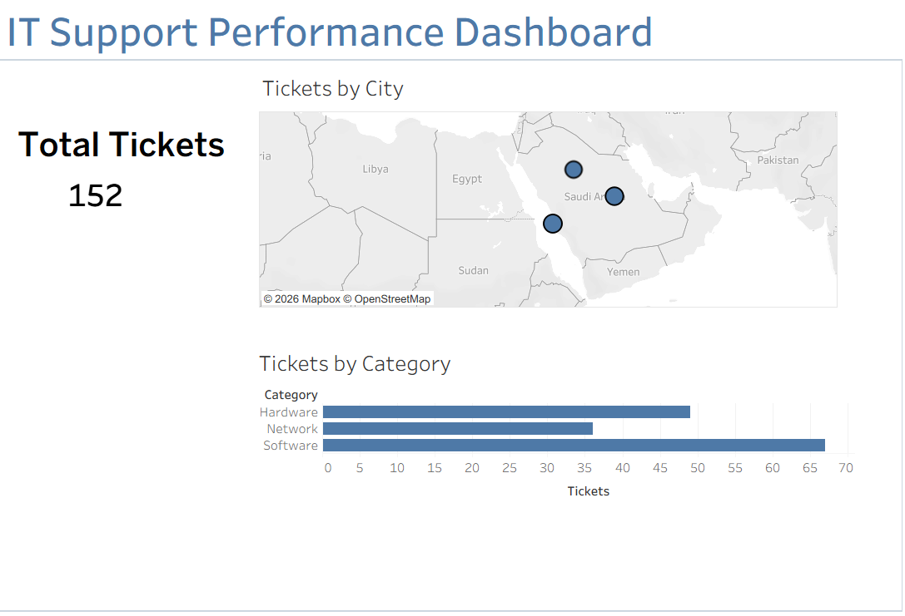

# IT Support Performance Dashboard

### Interactive Data Analytics & Visualization Project | Tableau Public

An interactive dashboard developed to analyze and visualize IT support tickets across multiple cities and technical issue categories.

This project was created as a hands-on learning exercise to strengthen practical skills in data analysis, data visualization, geographic mapping, KPI design, and interactive dashboard development using Tableau Public.

**Developer:** Shamma Thari Alreshidi  
**Project Date:** November 2026  
**Project Type:** Data Analytics & Visualization  
**Primary Tool:** Tableau Public  
**Status:** Completed and Published

---

## Live Interactive Dashboard

**[Explore the Dashboard on Tableau Public](https://public.tableau.com/app/profile/shamma.thari/viz/book1_17956673543020/ITSupportPerformanceDashboard)**

The published dashboard allows users to explore simulated IT support data and interact with geographic filters.

### Dashboard Preview

---

## Project Overview

The IT Support Performance Dashboard is an educational data visualization project designed to demonstrate how structured IT support data can be transformed into meaningful and interactive visualizations.

The dashboard analyzes simulated support requests from three cities in Saudi Arabia:

- Hail
- Riyadh
- Jeddah

It provides insights into:

- Total support ticket volume
- Geographic distribution of support requests
- Technical issue categories
- Differences in ticket volume between cities
- Interactive filtering of support data

The project focuses on presenting information clearly and making it easier to explore operational patterns.

---

## Tools & Technologies

**Data Visualization**
- Tableau Public
- Interactive Dashboards
- Geographic Mapping
- Bar Charts
- KPI Indicators

**Data Analysis**
- Data Aggregation
- Data Filtering
- Data Exploration
- Basic Analytical Reporting

**Data Preparation**
- Google Sheets
- CSV Data Files
- Structured Tabular Data
- Data Type Identification

**Documentation**
- GitHub
- Markdown

---

## Dashboard Features

### 1. Total Support Tickets

A KPI indicator displays the total number of support requests included in the dataset.

**Total Tickets: 152**

The KPI dynamically updates when a city is selected through the interactive map.

### 2. Geographic Ticket Distribution

An interactive geographic map displays ticket activity across:

- Hail
- Riyadh
- Jeddah

Each city is represented by a geographic data point.

Users can select a city to filter the dashboard and explore its associated ticket data.

### 3. Ticket Category Analysis

A horizontal bar chart visualizes the number of support tickets across three technical issue categories:

- Hardware
- Software
- Network

The chart helps identify which issue categories account for the largest share of requests.

### 4. Interactive Dashboard Filtering

The geographic map is connected to the other dashboard components through Tableau's interactive filtering functionality.

When a city is selected:

- The total ticket KPI updates.
- The category chart displays data for the selected city.
- Users can compare ticket distributions across different locations.

For example, selecting Hail displays 45 support tickets and their distribution across hardware, software, and network issues.

---

## Dataset

This project uses a fictional dataset created specifically for educational and portfolio purposes.

**[View the Sample Dataset](it-support-tickets.csv.csv)**

### Dataset Structure

| Field | Description |
|---|---|
| City | City associated with the support requests |
| Category | Technical issue category |
| Tickets | Number of support tickets |
| Resolved | Number of resolved tickets |

The dataset contains nine records representing combinations of three Saudi cities and three technical issue categories.

The dashboard primarily visualizes the City, Category, and Tickets fields.

**Data Privacy Notice:** All data in this project is simulated. It does not contain real customer information, confidential records, or actual organizational support tickets.

---

## Dashboard Results

### Tickets by City

| City | Total Tickets |
|---|---:|
| Hail | 45 |
| Riyadh | 52 |
| Jeddah | 55 |
| **Total** | **152** |

### Tickets by Category

| Category | Total Tickets |
|---|---:|
| Hardware | 49 |
| Software | 67 |
| Network | 36 |
| **Total** | **152** |

---

## Key Insights

Based on the simulated dataset:

**1. Highest Ticket Volume**

Jeddah recorded the highest number of support tickets, with 55 requests.

**2. Most Common Issue Category**

Software-related requests represented the largest category, with 67 tickets.

**3. Geographic Comparison**

The dashboard makes it possible to compare support activity between Hail, Riyadh, and Jeddah.

**4. Interactive Analysis**

City-based filtering enables users to examine the distribution of technical issues within individual locations.

These observations describe only the fictional dataset and should not be interpreted as findings about actual IT support operations.

---

## Development Process

### Step 1: Dataset Preparation

Created a small sample dataset containing city names, technical issue categories, total tickets, and resolved tickets.

Organized the data in a structured table and exported it as a CSV file.

### Step 2: Data Connection

Imported the CSV dataset into Tableau Public.

Reviewed the available data fields and checked the recognized data types.

### Step 3: KPI Development

Created a worksheet to calculate and display the total number of support tickets using Tableau's SUM aggregation.

### Step 4: Data Visualization

Developed horizontal bar charts to compare ticket counts across cities and technical issue categories.

### Step 5: Geographic Visualization

Created an interactive geographic map displaying the Saudi cities represented in the dataset.

### Step 6: Dashboard Design

Combined the total ticket KPI, geographic map, and category chart into one dashboard.

Adjusted the layout, text formatting, titles, and chart presentation.

### Step 7: Interactive Filtering

Configured the geographic map to function as an interactive filter.

Tested the filtering behavior to verify that the KPI and category chart updated when selecting a city.

### Step 8: Publishing

Published the completed dashboard on Tableau Public.

Documented the project and its dataset in this GitHub repository.

---

## Skills Demonstrated

- Data Analysis
- Data Visualization
- Tableau Public
- Interactive Dashboard Development
- KPI Development
- Geographic Data Visualization
- Data Aggregation
- Data Filtering
- Data Interpretation
- Analytical Thinking
- Problem-Solving
- Technical Documentation

---

## Learning Outcomes

Through this project, I gained practical experience in developing an interactive dashboard using Tableau Public.

I learned how to:

- Import and explore structured datasets.
- Work with dimensions and measures.
- Calculate and display aggregated values.
- Design charts and KPI indicators.
- Represent geographic information visually.
- Connect multiple visualizations through interactive filters.
- Organize charts into a user-friendly dashboard.
- Publish and document a data visualization project.

This project strengthened my foundational knowledge of data analytics and business intelligence and provided hands-on experience with Tableau.

---

## Project Files

| File | Description |
|---|---|
| [dashboard-preview.png](dashboard-preview.png) | Screenshot of the completed dashboard |
| [it-support-tickets.csv.csv](it-support-tickets.csv.csv) | Simulated IT support dataset |
| [README.md](README.md) | Project documentation |

The interactive Tableau workbook can be explored through the published Tableau Public link.

---

## Project Scope

This is an independent educational portfolio project.

It was developed to practice data visualization concepts and demonstrate the use of Tableau Public for interactive reporting.

The project does not represent a production IT support system or actual company operations.

All displayed values and observations are based on simulated training data.

---

## Developer

**Shamma Thari Alreshidi**  
Computer Engineering Graduate  
University of Hail, Saudi Arabia

**GitHub:** https://github.com/shamma-engineer

**LinkedIn:** https://www.linkedin.com/in/shamma-thari

**Tableau Public Profile:** https://public.tableau.com/app/profile/shamma.thari

**Live Dashboard:** https://public.tableau.com/app/profile/shamma.thari/viz/book1_17956673543020/ITSupportPerformanceDashboard
